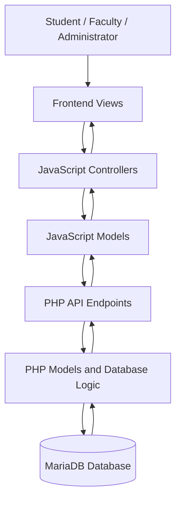

# ArchersHub

**A university enrollment and academic management web application inspired by De La Salle University.**


## Overview

ArchersHub is an academic web development project that recreates and enhances the university portal experience of De La Salle University. It provides a centralized interface for students, faculty members, and administrators to access academic information and perform role-specific tasks.

The project aims to improve usability, streamline enrollment-related processes, and demonstrate the integration of frontend development, backend programming, relational databases, authentication, and server deployment through a modular Model-View-Controller (MVC) architecture.

## Features

### Student

- Account registration using an `@dlsu.edu.ph` email address
- Login using a student ID and password
- Course browsing and enrollment-related interfaces
- Database-backed Add/Drop and section change requests
- Enrollment validation and pending request management
- Schedule, academic records, curriculum progression, and university calendar interfaces
- Special class, course withdrawal, and program exchange interfaces
- Access to published announcements

### Faculty

- Role-based dashboard and navigation
- Assigned classes and student roster retrieval
- Grade encoding and draft grade saving
- Schedule, university calendar, and application viewing interfaces

### Administrator

- User account creation and management
- Student, faculty, and administrator account management
- Announcement creation, editing, draft saving, and publishing
- Announcement visibility dates and required-field validation
- Academic records and enrollment-related interfaces

### General

- Responsive interface with DLSU-inspired styling
- Light and dark dashboard themes
- Session-based authentication and role-based access controls
- Password hashing, prepared SQL statements, and server-side input validation
- CSRF protection for supported authenticated write operations
- Modular frontend and PHP JSON API integration

## Technology Stack

| Component | Technology |
| --- | --- |
| Frontend | HTML5, CSS3, JavaScript (ES modules) |
| Backend | PHP, PDO |
| Database | MariaDB / MySQL-compatible SQL |
| Web server | Apache HTTP Server |
| Architecture | Model-View-Controller (MVC) |
| Local development | XAMPP on macOS |
| Server deployment | LAMP on Ubuntu Server |
| Version control | Git and GitHub |

## System Architecture



The application separates presentation, application behavior, and data access into modular components:

- **Model:** Handles data retrieval, API communication, and database operations.
- **View:** Displays the user interface, forms, tables, and feedback messages.
- **Controller:** Handles user interactions, validation, navigation, and coordination between models and views.
- **PHP API:** Processes requests, enforces backend validation and authorization, and returns JSON responses.

## Project Structure

```text
archersHub_fixed/
├── index.php                 # Entry point and login redirect
├── frontEnd/                 # User-facing application
│   ├── index.html            # Login page
│   ├── register.html         # Student registration page
│   ├── home.html             # Main dashboard
│   ├── css/                  # Stylesheets
│   ├── images/               # Image assets
│   └── js/
│       ├── controllers/      # User interactions and application logic
│       ├── models/           # Data access and API communication
│       └── views/            # UI rendering and presentation logic
├── backEnd/
│   ├── config/               # Database connection configuration
│   └── models/               # Backend data models
├── database/                 # Database scripts and setup resources
└── public/
    └── api/                  # PHP API endpoints
```

This is a simplified directory overview. Match the exact capitalization of directories and filenames in the repository, especially when deploying to Linux.

## Database

The application uses a relational database named `archershub_db`. Its core tables include:

| Table | Purpose |
| --- | --- |
| `users` | User accounts, roles, and authentication information |
| `programs` | Academic programs |
| `academic_terms` | Academic years, terms, and enrollment periods |
| `courses` | Course information |
| `sections` | Available course sections |
| `section_schedules` | Class schedules |
| `enrollments` | Student enrollment records |
| `faculty_assignments` | Faculty-to-section assignments |
| `grades` | Student grades and grade status |
| `announcements` | University announcements |

## Installation and Setup

### Prerequisites

- Apache HTTP Server
- PHP 8.1 or newer with PDO MySQL and mbstring extensions
- MariaDB or a compatible MySQL server
- Git (for cloning the repository)
- A compatible database SQL export or initialization script

### 1. Local Setup Using XAMPP

1. Install XAMPP and start Apache and MySQL/MariaDB.
2. Clone or copy the project into the XAMPP `htdocs` directory.
3. Open phpMyAdmin at `http://localhost/phpmyadmin/`.
4. Create a database named `archershub_db`.
5. Import the provided database SQL script into the database.
6. Configure the database connection in `backEnd/config/database.php` using the appropriate local credentials.
7. Open `http://localhost/archersHub_fixed/` in a browser, adjusting the folder name to match your installation.

### 2. Server Deployment Using LAMP (Ubuntu)

Install the required packages if they are not already available:

```bash
sudo apt update
sudo apt install apache2 mariadb-server php libapache2-mod-php php-mysql php-mbstring git
sudo systemctl enable --now apache2 mariadb
```

Clone the repository into the Apache document root using the appropriate repository URL and branch. Keep the directory name consistent with the application's configured paths.

Create the database:

```bash
sudo mariadb -e "CREATE DATABASE IF NOT EXISTS archershub_db CHARACTER SET utf8mb4 COLLATE utf8mb4_unicode_ci;"
```

Import the SQL export into an empty database (adjust the path to your private copy of the SQL file):

```bash
sudo mariadb archershub_db < /path/to/archershub_db.sql
```

Create a dedicated database account in the MariaDB console:

```sql
CREATE USER 'archershub_app'@'localhost' IDENTIFIED BY 'REPLACE_WITH_STRONG_PASSWORD';
GRANT SELECT, INSERT, UPDATE, DELETE ON archershub_db.* TO 'archershub_app'@'localhost';
```

Configure the application using the database settings below. Ensure Apache/PHP can read the configuration, and restart Apache if its environment configuration has changed.

Access the application through the server's assigned hostname, HTTP port, and project directory.

### Database Configuration

The connection is centralized in `backEnd/config/database.php` and supports the following environment variables:

| Variable | Description | Example |
| --- | --- | --- |
| `DB_HOST` | Database host | `localhost` |
| `DB_PORT` | Database port | `3306` |
| `DB_NAME` | Database name | `archershub_db` |
| `DB_USER` | Database username | `archershub_app` |
| `DB_PASSWORD` | Database password | Set privately on the server |

Configure these variables in the PHP/Apache runtime environment or use a private server-local configuration. Never commit actual passwords or sensitive database exports to GitHub.

To verify the database connection, use the application's `public/api/health.php` endpoint during development. Restrict or disable diagnostic endpoints before public deployment.

## Testing and Deployment Status

The project has been developed and tested locally using XAMPP and initially deployed to an Ubuntu-based LAMP server. Login, database connectivity, and Add/Drop functionality have been confirmed on the server.

Development testing covers authentication, role-based navigation, enrollment validation, student registration, database persistence, announcement management, and draft grade encoding. Full server-side regression testing remains ongoing.

## Current Limitations and Future Enhancements

- Complete grade finalization and student academic records integration.
- Complete announcement attachment uploads, previews, and downloads.
- Replace remaining demonstration interfaces and mock data with database-backed functionality.
- Improve deployment portability by removing hardcoded project paths.
- Complete deployment security hardening and regression testing.
- Add institutional email ownership verification and registration abuse prevention before any production use.

## Security and Privacy

ArchersHub is an academic prototype, not an official production university system. Student registration currently validates the institutional email domain but does not verify email ownership or enrollment eligibility.

Use synthetic demonstration data only. Keep database backups, credentials, and private configuration files outside publicly accessible directories and out of version control. Restrict direct web access to backend configuration and database resources, and use HTTPS before handling real credentials or personal information.

## Acknowledgments

Developed as part of a Web Application Development course at De La Salle University. The project applies concepts in MVC architecture, database management, web application security, and Linux-based server deployment.

ArchersHub is an educational project inspired by the university portal and is not an official De La Salle University service.
